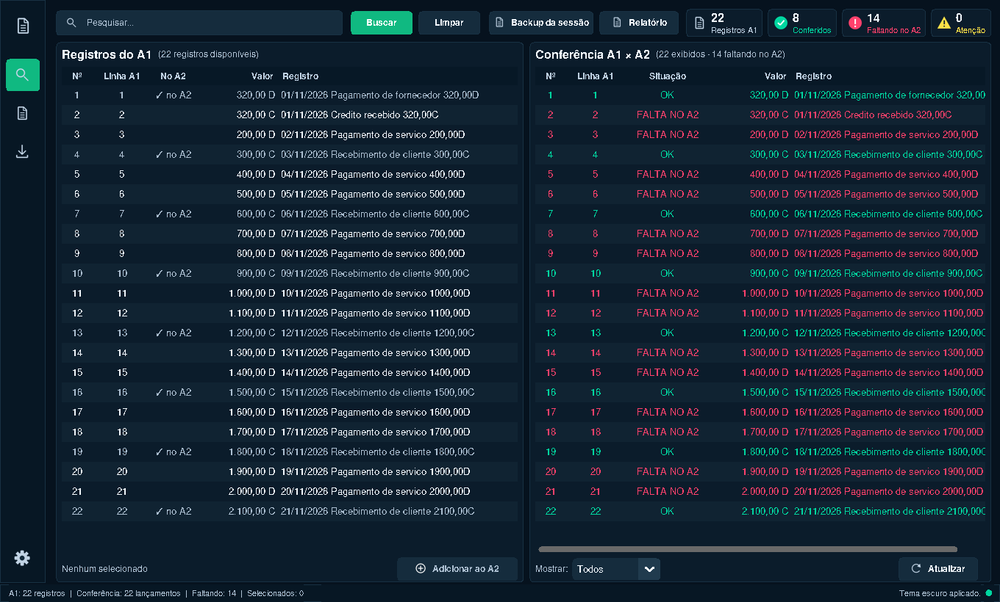
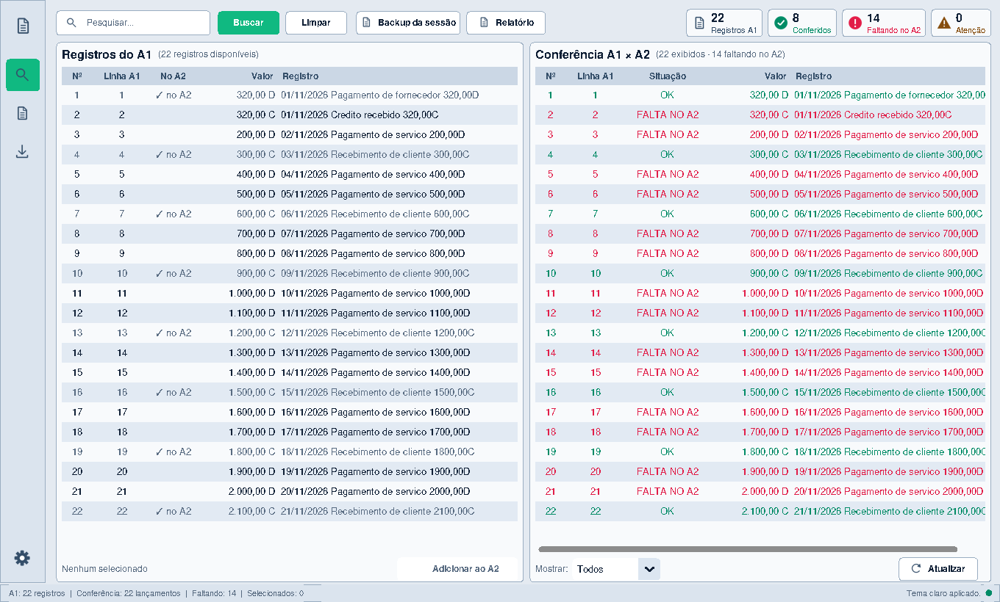
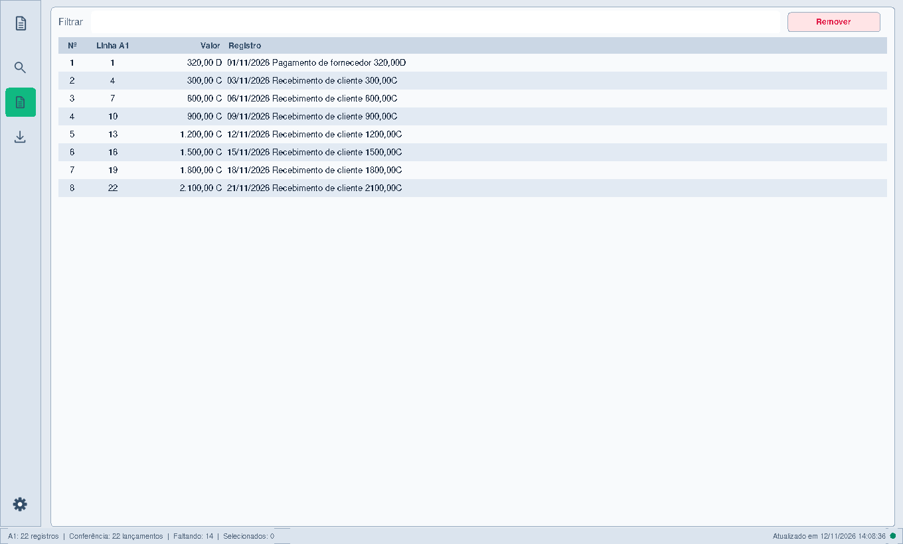
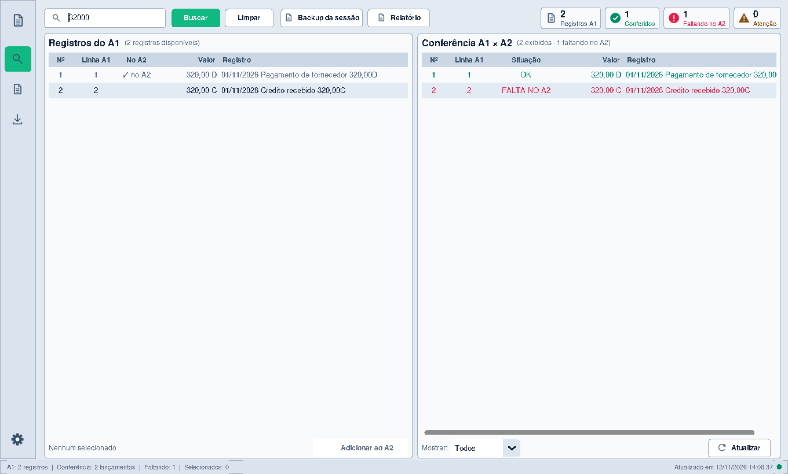
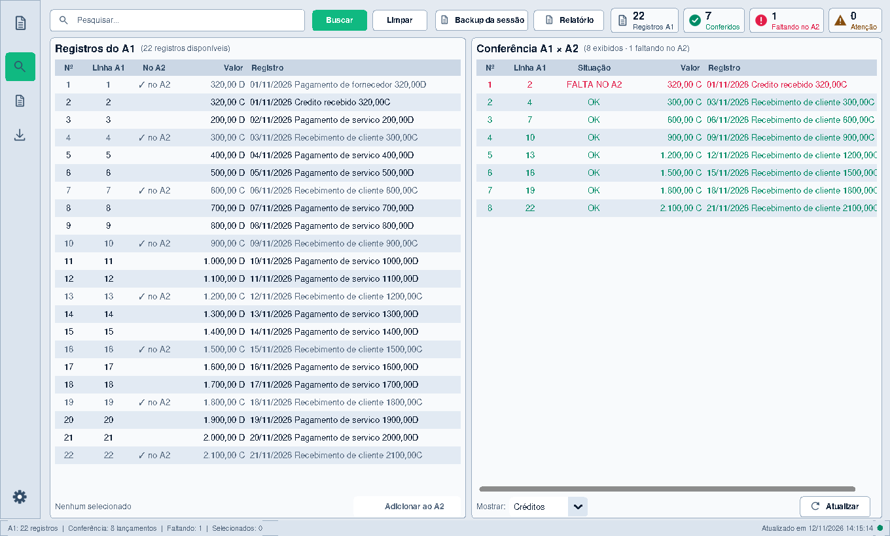

# Organiza-o

Aplicativo desktop em português, feito com CustomTkinter, para pesquisar registros
do A1, organizar uma seleção no A2 e comparar débitos e créditos em um relatório imprimível.

## Telas atuais

Capturas reais do aplicativo com dados fictícios, sem alterar arquivos de uso.
A aparência das fontes pode variar conforme o sistema operacional.

### Tela inicial — Buscar e comparar

Reúne os registros do **A1 à esquerda** e a **conferência A1 × A2 à direita**.
Uma única pesquisa filtra os dois painéis. Ao selecionar e usar **Adicionar ao A2**,
a situação é atualizada ao lado, mantendo a pesquisa. Arraste a divisória central
para ajustar o espaço de cada painel.

A composição visual segue as referências clara e escura do briefing: título,
abas, seletores de tema/cor e **Aparência** na mesma linha, com 46 pixels.
A pesquisa tem ícone de lupa, campo **Pesquisar**, **Buscar** e **Limpar**, ao lado
dos cartões **Registros A1**, **Conferidos** e **Faltando no A2**. Os cartões
acompanham os dados exibidos: **Conferidos** conta somente lançamentos OK,
considerando a pesquisa e o filtro de tipo.
As tabelas ficam alinhadas em painéis com bordas finas, larguras iniciais iguais
e linhas alternadas. As contagens ficam junto dos títulos, na mesma linha.
**Adicionar ao A2** fica no rodapé do A1, ao lado da quantidade selecionada,
e só é habilitado com uma seleção. **Atualizar** e **Relatório** ficam no rodapé
da conferência. O filtro **Todos / Débitos / Créditos** fica no mesmo rodapé,
à esquerda dos botões. Os botões têm 30 a 32 pixels e a pesquisa tem 34 pixels.
As linhas de 27 pixels, com fonte de 13 pixels, permitem exibir mais registros.
As tabelas crescem com a janela até os botões inferiores; o rodapé global tem
24 pixels e reúne contadores, quantidade selecionada e estado da atualização. As medidas acompanham a
escala do sistema e são iguais nos temas claro e escuro.
Os seletores de tema e cor ficam visíveis no cabeçalho e podem ser recolhidos
pelo botão **Aparência**. Os controles usam ícones desenhados no aplicativo,
sem depender de símbolos especiais nas fontes do computador.
**Esmeralda** é o destaque inicial; as preferências já salvas continuam válidas.
A situação aparece antes do registro, ficando visível mesmo em linhas longas.
Na conferência, registros **OK** ficam em verde e **FALTA NO A2** em vermelho,
tanto no tema claro quanto no escuro.
O tema escuro usa fundos em azul profundo e o claro mantém os painéis brancos,
com bordas discretas e faixas alternadas para acompanhar cada linha.
A seleção da conferência preserva o verde e o vermelho sobre um fundo azul
adequado a cada tema; linhas selecionadas no A1 e na Lista A2 usam texto branco.
O botão de inclusão fica neutro enquanto não houver seleção.

As três tabelas exibem a coluna **Valor**, alinhada à direita, antes de **Registro**.
Ela mostra o valor brasileiro e o marcador D/C, como `3.814,88 C`, e fica vazia em
linhas sem valor marcado com D/C. Essa apresentação não altera o registro original, os
arquivos, a pesquisa ou as regras de comparação.

As barras de rolagem aparecem apenas quando há conteúdo fora da área visível.
O cabeçalho aproveita melhor a altura da janela, e o filtro da Lista A2 se
expande com a largura disponível. A janela inicial considera o tamanho da tela;
mensagens longas no rodapé são abreviadas para manter uma única linha.
Clique na mensagem de status para ler seu conteúdo completo.
Duplo clique adiciona apenas o registro clicado: cabeçalhos e áreas vazias não
adicionam a seleção anterior. Limpar a seleção também limpa o outro painel.

As imagens abaixo formam a galeria visual atual do aplicativo, incluindo pesquisa,
filtro de créditos, lista A2 e comparação. As tabelas mantêm as colunas
aprovadas, sem a coluna **Tipo**, e **Registro** é dimensionado pelo conteúdo.
Use a barra horizontal para ler linhas longas por inteiro e arraste a divisória
central para ampliar um dos painéis.

#### Tela principal e comparação





### Lista A2

Mostra os registros escolhidos, mantendo a referência original do A1. Permite
filtrar, remover e exportar a seleção.



### Pesquisa compartilhada

Pesquisar `32000` encontra os registros de `320,00` nos dois lados. Neste exemplo,
o débito já está no A2 e o crédito ainda falta: o mesmo valor com tipos diferentes
é conferido separadamente. **Limpar** limpa a pesquisa dos dois painéis.



### Capturar documento pelo telefone

A aba **Capturar documento** recebe fotos de notas fiscais, cupons, recibos e
extratos pelo telefone, sem enviar a imagem para a internet. Clique em
**Iniciar captura** no computador e abra no telefone o endereço exibido (os dois
dispositivos precisam estar na mesma rede Wi-Fi). Se o QR Code estiver
disponível, ele também pode ser escaneado.

Depois do envio, o OCR local preenche uma revisão com descrição, data, valor e
tipo (`D` para débito ou `C` para crédito). Revise e edite os campos e clique em
**Verificar no A1 e adicionar ao A2**. O programa só inclui automaticamente
quando encontra uma única linha do A1 com a mesma data, valor e tipo D/C.
Antes de reconhecer o texto, a imagem tem orientação, pequenas inclinações,
contraste, escala e nitidez tratados localmente, preservando traços finos.
O OCR faz duas leituras em português: uma em tons de cinza e outra com contraste
preto e branco calculado pela imagem. Ele escolhe a leitura mais confiante,
sem substituir letras por números ou inventar caracteres. Se as leituras
divergirem na data, no valor ou no tipo, ou houver baixa confiança no texto ou
nos números, o documento aguarda revisão e confirmação manual antes de entrar
no A2. Cada leitura tem limite de 20 segundos. Na interpretação, rótulos como
**Total**, **Total a pagar**, **Valor final** e **Pago** têm prioridade sobre
subtotal, itens e troco.
Se o OCR não conseguir identificar os campos essenciais, a foto é descartada
com um aviso na tela e não fica presa aguardando revisão. Duplicidades e
documentos sem correspondência permanecem para revisão. A linha incluída recebe
uma cor própria na conferência **A1 × A2** durante a sessão.
Ao escolher uma foto no celular, o envio começa automaticamente; não é
necessário clicar em outro botão. O formulário aceita várias fotos na mesma
remessa e mantém uma fila de revisão. Durante o OCR, a imagem usa um arquivo
temporário, removido ao concluir a leitura; o aplicativo não arquiva as fotos. A validação automática inclui no `a2.txt`
somente a linha correspondente do `a1.txt`; a conferência continua sendo feita
exclusivamente entre esses dois arquivos.

O projeto inclui uma cópia portátil do Tesseract em `Tesseract-OCR/`, com o
modelo de português, e usa seu executável automaticamente no Windows. Assim,
não é necessário instalar o Tesseract no Windows. No Linux, instale o executável `tesseract-ocr`
pelo gerenciador do sistema; o modelo de português incluído no projeto também
é utilizado. Se a cópia portátil não estiver presente no Windows, o aplicativo
tenta usar uma instalação disponível no sistema. Se o OCR falhar ou não extrair
os campos essenciais, o aplicativo informa o descarte da foto. Quando houver
texto com campos essenciais, mas leitura incerta, os campos ficam editáveis
para revisão manual. O servidor aceita somente imagens de até 15 MB e deve ser parado depois
do uso. O recurso não interpreta contratos nem substitui a conferência humana.

### PaddleOCR opcional e comparação dos mecanismos

O Tesseract continua sendo a opção inicial. Em **Capturar documento**, o seletor
**Leitura da imagem** permite escolher **PaddleOCR** ou **Comparar**. O PaddleOCR
usa modelos leves PP-OCRv5 para detecção e reconhecimento de caracteres latinos,
com orientação de documento e de linhas, executados na CPU.

Para instalar a opção, use Python 3.11 a 3.13, em um sistema compatível com as
wheels do PaddlePaddle (Windows/Linux x64 ou macOS ARM64):

```sh
uv sync --frozen --extra paddle
uv run --frozen --extra paddle python ocr_paddle.py
uv run --frozen --extra paddle python main.py
```

O segundo comando prepara os modelos: a primeira execução precisa de internet
para baixar os pesos oficiais. Nenhuma foto é enviada. Os modelos ficam no
cache local do PaddleX (`~/.paddlex` por padrão); depois do preparo a leitura
usa os arquivos locais. O PaddleOCR carrega somente quando selecionado e
processa a fila em segundo plano, mantendo a janela responsiva.

Mantenha `--extra paddle` ao executar os comandos `uv sync`/`uv run` para
preservar a instalação opcional. No Windows, `iniciar.bat` também preserva os
pacotes opcionais já instalados. Sem a opção instalada, o seletor mostra a
orientação de instalação; o Tesseract continua disponível.

**Comparar** lê a mesma imagem com os dois mecanismos, mostra o texto do
PaddleOCR e informa concordância ou divergência em data, valor e tipo. Nesse
modo a confirmação é sempre manual. Se o PaddleOCR falhar, a leitura do
Tesseract fica disponível para revisão. Nenhum mecanismo garante acerto de
caracteres ou valores somente pela confiança informada.

Para comparar texto, campos e tempo de execução localmente, sem alterar A1/A2:

```sh
uv run --frozen --extra paddle python scripts/comparar_ocr.py foto1.png foto2.jpg
```

O resultado JSON sai no terminal. Compare os campos com os valores verdadeiros
do documento; a primeira imagem também inclui o tempo de carregar os modelos.
Fotos reais ainda precisam ser avaliadas antes de mudar o mecanismo padrão.
A captura exige igualdade numérica do valor com o lançamento do A1: `100,00`
nunca corresponde a `1.100,00`, mesmo que a pesquisa textual encontre ambos.

### Filtro de créditos

O filtro da direita permite conferir somente créditos ou somente débitos; o A1
continua disponível à esquerda. Os contadores e o relatório acompanham a pesquisa
e o tipo selecionado. A sequência **Nº** recomeça em 1 e **Linha A1** mantém a referência original.



### Arquivos de referência

[Interface.png](Interface.png) mostra a interface atual. O [diagrama original](Diagrama.png)
é uma referência histórica da organização do projeto, não uma captura do aplicativo.

## Executar

Requer Python 3.11 ou superior, Tk e uma sessão gráfica. Com o [uv](https://docs.astral.sh/uv/),
execute na pasta do projeto:

```sh
uv sync --frozen
uv run --frozen python main.py
```

O aplicativo cria `a1.txt`, `a2.txt` e a pasta `No/` no diretório de execução.
Mantenha esse diretório ao reiniciar para acessar os mesmos dados. Esses arquivos
são locais e ignorados pelo Git; faça cópias de segurança dos registros importantes.

## Atualizar a cópia no computador

Uma atualização no GitHub não substitui o programa já salvo no computador. A versão
atual tem os cartões **Registros A1**, **Conferidos** e **Faltando no A2**, além das
duas tabelas lado a lado. [Veja a captura atual](Interface.png).

Se você clonou o projeto com Git, feche o programa e execute na pasta do projeto:

```sh
git pull --ff-only
uv sync --frozen
uv run --frozen python main.py
```

Se baixou um ZIP, [baixe a branch main novamente](https://github.com/FernandoAAB/Organiza-o/archive/refs/heads/main.zip)
e extraia em uma pasta nova. Copie `a1.txt`, `a2.txt` e a pasta `No/` da instalação
anterior para essa pasta, mantendo os originais como cópia de segurança. Execute
os comandos de instalação e inicialização acima, sem o comando `git pull`.
Abra o `main.py` da pasta nova; um atalho para a pasta anterior continuará abrindo
a versão anterior. As dependências atuais incluem Pillow para desenhar os ícones.

Se você usa um `.exe`, baixar o `main.py` não altera esse executável. Este repositório
contém o código-fonte; um executável antigo precisa ser substituído por uma nova
compilação, ou você pode executar o código atualizado como descrito acima.

## Uso e comparação

1. Preencha `a1.txt` com um registro por linha. Linhas vazias são ignoradas,
   preservando a numeração original. Use UTF‑8; arquivos UTF‑8 com BOM também são aceitos.
2. Em **Buscar e comparar**, digite texto, data ou valor e pressione Enter ou
   clique em **Buscar**. Por exemplo, `145330` encontra `1.453,30`.
   A pesquisa filtra simultaneamente o A1 e a comparação, preservando a ordem original.
   Os filtros de tipo e o relatório usam a última pesquisa confirmada; digitar
   um novo termo sem pressionar Enter ou **Buscar** não altera os resultados.
3. Selecione os registros à esquerda e clique em **Adicionar ao A2**, ou use
   duplo clique. A indicação no A1 e a situação na direita são atualizadas sem
   trocar de aba. A seleção localiza a mesma linha no painel ao lado; Ctrl/Shift
   permite escolher vários registros. A comparação contém lançamentos com D/C;
   saldos e o resumo do extrato ficam fora da contagem. Lançamentos futuros
   continuam disponíveis para conferência e mantêm a linha original do A1.
   Se o A1 for editado em outro programa e a linha escolhida mudar, a inclusão
   é interrompida e a lista atualizada para você selecionar novamente.
4. Confira as pendências à direita. **Todos / Débitos / Créditos** filtra o tipo
   apenas nesse painel, e os contadores mostram as quantidades visíveis. **Relatório**
   abre `No/relatorio_debitos.html` no navegador, com a mesma pesquisa e tipo.
   O nome do arquivo foi mantido para compatibilidade; ele agora inclui créditos também.
5. Em **Lista A2**, filtre, remova registros ou exporte a seleção para `No/N.txt`.
   A exportação contém todo o A2, na ordem das linhas originais.

Para marcar um lançamento como **Atenção**, dê dois cliques em qualquer célula
da linha na tabela **Conferência A1 × A2** (painel da direita). A linha ganha
texto e fundo em tom amarelo; dê dois cliques novamente para remover a marcação.
O novo cartão **Atenção**, com ícone amarelo no topo, conta as marcações visíveis,
acompanhando a pesquisa e o filtro de débitos/créditos. A situação **OK** ou
**FALTA NO A2** e os contadores financeiros continuam representando a comparação.

As marcações são salvas automaticamente em `No/atencao.json` e reaparecem ao
reabrir o programa no mesmo diretório. Elas usam a linha original e o texto do
registro, tolerando diferenças de espaçamento. Se outra linha ou outro texto
substituir aquele registro no A1, a marcação não é transferida. Inclua a pasta
`No/` na cópia de segurança para preservar as marcações. O duplo clique no painel
A1 à esquerda continua adicionando ao A2; o marcador de atenção atua somente
no painel de conferência à direita.

A pesquisa não muda o resultado da conferência: os lançamentos são comparados
antes de filtrar a visualização, evitando que uma busca altere qual ocorrência
de um valor repetido está marcada como OK. Pesquisar uma data busca esse texto
no registro; a ordenação permanece pela linha original, sem interpretar datas.

Um débito é identificado por um valor brasileiro seguido de `D`, por exemplo
`Cliente 1.453,30 D`. Um crédito termina em `C`, como `Cliente 100,00 C`.
Os marcadores D/C identificam a saída e a entrada; o sinal negativo não é exigido.
O formato original com valor colado no histórico (`ENVIO TED320,00 D`) também é aceito.
Valores como
`1.453,30` e `1453,3` são equivalentes para a pesquisa e para a leitura do
lançamento, mas a conferência A1 × A2 exige a linha inteira igual. O prefixo
`[linha]` do A2 é ignorado nessa comparação; espaços e tabulações diferentes são
tolerados. Cada ocorrência de uma linha do A1 consome uma ocorrência igual no A2.
Assim, valores iguais com descrições, datas ou tipos diferentes não conferem.
**Situação** mostra `OK` ou `FALTA NO A2`; o valor e o marcador D/C permanecem
no registro, dispensando uma coluna **Tipo** na tabela e no relatório.
Valores negativos do extrato, como `-700,00D`, também são reconhecidos;
a conferência usa o valor absoluto e o marcador D/C.
Os contadores mostram quantidades de registros.
Linhas sem valor marcado com D/C, como `0SALDO DIA` no exemplo original,
continuam disponíveis no A1 e no A2, mas não entram na comparação financeira.

Todas as abas exibem **Nº** em ordem crescente de 1 até o fim da lista exibida,
sem limite de 30 registros. Ao filtrar A1 ou A2, essa sequência recomeça em 1.
**Linha A1** mantém a referência original, inclusive quando existem linhas vazias
ou registros que não são débitos. O A2 é exibido e exportado pela linha original do A1
(1, 2, 3…), independentemente da ordem de seleção. A numeração de
exibição não altera os arquivos nem os identificadores `[linha]` gravados no A2.
O relatório também contém as colunas **Nº** e **Linha A1**.

A ordem de referência é a sequência das linhas do A1. O identificador `[12]`
no A2 significa que o registro veio da linha 12 do A1; não representa o dia 12.
Códigos numéricos no começo do texto também não são tratados como datas.
Mesmo que uma descrição contenha datas, ela não muda a ordem original.
O arquivo de exemplo do commit `5ac63f7` contém 98 registros sem datas explícitas.

O relatório trata o conteúdo dos registros como texto, inclusive caracteres
como `<`, `>` e `&`. A impressão depende do navegador e da impressora disponível.

## Desenvolvimento e validação

Após `uv sync --frozen`, execute a suíte completa em uma sessão gráfica:

```sh
uv run --frozen python scripts/test.py --require-gui
```

No Linux com Xvfb instalado, use:

```sh
xvfb-run -a uv run --frozen python scripts/test.py --require-gui
```

O comando verifica comparação, indicadores, cliques, seleção, rolagem, mensagens e
redimensionamento, incluindo 1366 × 768, 1600 × 900 e 1920 × 1080,
nos dois temas e em escalas de 100% e 125%. Ele falha se houver erros, se nenhum
teste for encontrado ou se algum teste for ignorado. Para uma verificação parcial sem sessão gráfica,
omita `--require-gui`: os testes da interface serão indicados como ignorados,
e o resultado não valida a interface. A execução por
`python -m unittest discover -s tests -v` continua disponível.

O [workflow de testes](.github/workflows/tests.yml) executa a suíte completa no
Windows e no Linux, com Python 3.11 e 3.12, em pushes para `main` e pull requests.
Os testes usam arquivos temporários, preservando os dados de uso. As orientações
para agentes estão em [AGENTS.md](AGENTS.md).

As práticas foram adaptadas do repositório [mattpocock/skills](https://github.com/mattpocock/skills/tree/5beb35b040e3de97e54fa9e386d7e42d15c295c2),
especialmente [writing-for-agents](https://github.com/mattpocock/skills/blob/5beb35b040e3de97e54fa9e386d7e42d15c295c2/skills/productivity/writing-for-agents/SKILL.md)
e as recomendações de [testes por comportamento](https://github.com/mattpocock/skills/blob/5beb35b040e3de97e54fa9e386d7e42d15c295c2/skills/engineering/tdd/tests.md).

## Guia dos arquivos

Consulte os [comentários de cada arquivo](docs/ARQUIVOS.md) para entender a estrutura do projeto e os componentes distribuídos com o Tesseract.
