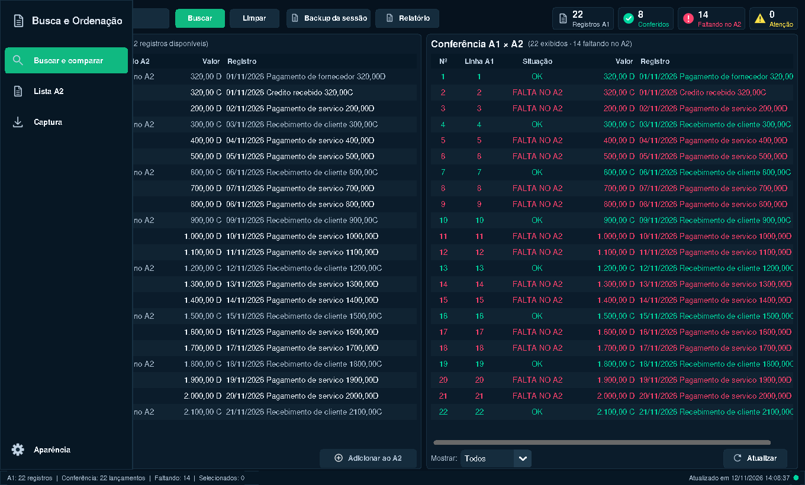

# Organiza-o

Aplicativo desktop em português, feito com CustomTkinter, para pesquisar registros
do A1, organizar uma seleção no A2 e comparar débitos e créditos em um relatório imprimível.

## Interface e navegação

O menu lateral começa recolhido, mostrando apenas ícones. Passe o mouse sobre ele
para ver **Buscar e comparar**, **Lista A2**, **Captura** e **Aparência**. Ao sair,
ele recolhe após uma breve pausa. A expansão se sobrepõe ao conteúdo, sem deslocar
as tabelas; os botões também podem receber foco com Tab.

**Aparência**, na parte inferior do menu, abre os seletores de tema e cor ao lado
da barra. Esse painel permanece aberto até você clicar novamente em **Aparência**.
As preferências são salvas. **Esmeralda** é o destaque inicial; preferências já
salvas continuam válidas. Os ícones são desenhados pelo aplicativo, sem depender
de símbolos especiais nas fontes do computador.

As capturas desta página mostram a versão atual com dados fictícios, sem alterar
os arquivos de uso. Incluem o menu lateral e a pesquisa na mesma linha dos
contadores. A aparência das fontes pode variar conforme o sistema operacional.

### Tela inicial — Buscar e comparar

Reúne os registros do **A1 à esquerda** e a **conferência A1 × A2 à direita**.
Uma única pesquisa filtra os dois painéis. Ao selecionar e usar **Adicionar ao A2**,
a situação é atualizada ao lado, mantendo a pesquisa. Arraste a divisória central
para ajustar o espaço de cada painel.

A faixa superior reúne, na mesma linha, o campo **Pesquisar**, os botões
**Buscar**, **Limpar**, **Backup da sessão** e **Relatório** e os quatro contadores compactos:

| Indicador | Símbolo | O que mostra |
| --- | --- | --- |
| Registros A1 | Documento | Quantidade de registros do A1 exibidos pela pesquisa. |
| Conferidos | Confirmação verde | Lançamentos OK na conferência exibida. |
| Faltando no A2 | Alerta vermelho | Lançamentos exibidos que ainda faltam no A2. |
| Atenção | Triângulo amarelo | Marcações de atenção visíveis. |

O campo de pesquisa ocupa o espaço disponível depois de acomodar os botões. Os contadores ficam
agrupados, com ícones próximos dos números e dos textos, sem esticar os cartões
por toda a tela. O título grande acima da pesquisa foi removido para liberar
altura às tabelas. Os contadores da conferência acompanham a pesquisa e o filtro
de tipo.

As tabelas ficam alinhadas em painéis com bordas finas, larguras iniciais iguais
e linhas alternadas. As contagens ficam junto dos títulos, na mesma linha.
**Adicionar ao A2** fica no rodapé do A1, ao lado da quantidade selecionada,
e só é habilitado com uma seleção. **Atualizar** fica no rodapé da conferência;
o filtro **Todos / Débitos / Créditos** fica à esquerda nesse mesmo rodapé.
**Relatório** fica junto da pesquisa e usa a pesquisa confirmada e o filtro de
tipo da conferência.
**Backup da sessão** fica imediatamente antes de **Relatório** e guarda uma
cópia dos registros e das marcações. Em janelas estreitas, os contadores passam
para a segunda linha para manter os botões e a pesquisa acessíveis.

As linhas de 27 pixels, com fonte de 13 pixels, permitem exibir mais registros.
As tabelas crescem com a janela até os botões inferiores; o rodapé global reúne
contadores, quantidade selecionada e estado da atualização em uma única linha.
As medidas acompanham a escala do sistema e são iguais nos temas claro e escuro.
A situação aparece antes do registro, ficando visível mesmo em linhas longas.
Na conferência, registros **OK** ficam em verde e **FALTA NO A2** em vermelho,
tanto no tema claro quanto no escuro.
O tema escuro usa fundos em azul profundo. O tema claro diferencia o fundo
cinza-azulado, os campos brancos e os painéis claros, com bordas mais marcadas,
cabeçalhos sombreados e faixas alternadas de maior contraste nas tabelas.
A seleção da conferência preserva o verde e o vermelho sobre um fundo azul
adequado a cada tema; linhas selecionadas no A1 e na Lista A2 usam texto branco.
O botão de inclusão fica neutro enquanto não houver seleção.

As três tabelas exibem a coluna **Valor**, alinhada à direita, antes de **Registro**.
Ela mostra o valor brasileiro e o marcador D/C, como `3.814,88 C`, e fica vazia em
linhas sem valor marcado com D/C. Essa apresentação não altera o registro original, os
arquivos, a pesquisa ou as regras de comparação.

As barras de rolagem aparecem apenas quando há conteúdo fora da área visível.
A faixa superior compacta libera altura para as tabelas, e o filtro da Lista A2 se
expande com a largura disponível. A janela inicial considera o tamanho da tela;
mensagens longas no rodapé são abreviadas para manter uma única linha.
Clique na mensagem de status para ler seu conteúdo completo.
Duplo clique adiciona apenas o registro clicado: cabeçalhos e áreas vazias não
adicionam a seleção anterior. Limpar a seleção também limpa o outro painel.

As imagens abaixo mostram a interface atual, incluindo pesquisa,
filtro de créditos, lista A2 e comparação. As tabelas mantêm as colunas
aprovadas, sem a coluna **Tipo**, e **Registro** é dimensionado pelo conteúdo.
Use a barra horizontal para ler linhas longas por inteiro e arraste a divisória
central para ampliar um dos painéis.

#### Tela principal e comparação





### Lista A2

Mostra os registros escolhidos, mantendo a referência original do A1. Permite
filtrar e remover registros. O backup completo da sessão fica na tela principal.


### Pesquisa compartilhada

Pesquisar `32000` encontra os registros de `320,00` nos dois lados. Neste exemplo,
o débito já está no A2 e o crédito ainda falta: o mesmo valor com tipos diferentes
é conferido separadamente. **Limpar** limpa a pesquisa dos dois painéis.


### Capturar documento pelo telefone

A aba **Capturar documento** recebe fotos de notas fiscais, cupons, recibos e
extratos pelo telefone, sem enviar a imagem para a internet. Clique em
**Iniciar captura** no computador e abra no telefone o endereço exibido (os dois
dispositivos precisam estar na mesma rede Wi-Fi). Se o QR Code estiver
disponível, ele também pode ser escaneado.

Depois do envio, o OCR local preenche uma revisão com descrição, data, valor e
tipo (`D` para débito ou `C` para crédito). A descrição é apenas informativa:
pode ser diferente do histórico do extrato ou estar vazia, sem impedir a busca.
Ela fica disponível para consulta, sem edição. A localização no A1 considera
somente **data, valor exato e tipo D/C**; se esses três campos coincidirem em
mais de um lançamento, a inclusão automática aguarda revisão.
Revise e edite data, valor e tipo e clique em
**Verificar no A1 e adicionar ao A2**. O programa só inclui automaticamente
quando encontra uma única linha do A1 com a mesma data, valor e tipo D/C.
Antes de reconhecer o texto, a imagem tem orientação, pequenas inclinações,
contraste, escala e nitidez tratados localmente, preservando traços finos.
O OCR faz duas leituras em português: uma em tons de cinza e outra com contraste
preto e branco calculado pela imagem. Ele escolhe a leitura mais confiante,
sem substituir letras por números ou inventar caracteres. Se as leituras
divergirem na data, no valor ou no tipo, ou houver baixa confiança no texto ou
nos números, o documento aguarda revisão e confirmação manual antes de entrar
no A2. Cada leitura tem limite de 20 segundos. Na interpretação, rótulos como
**Total**, **Total a pagar**, **Valor final** e **Pago** têm prioridade sobre
subtotal, itens e troco.
Se o OCR falhar ou não conseguir identificar os campos essenciais, a folha
aparece em **Falhas no processamento**, com o motivo e a imagem preservada.
As outras fotos continuam na fila. No painel do telefone, **Tentar novamente**
recoloca a mesma folha na fila, com o mesmo número; **Descartar** remove sua
imagem e registra o descarte. Falhas ficam guardadas ao reiniciar e só são
reprocessadas quando solicitado. Duplicidades e
documentos sem correspondência permanecem para revisão. A linha incluída recebe
uma cor própria na conferência **A1 × A2** durante a sessão.
Ao escolher uma foto no celular, o envio começa automaticamente; não é
necessário clicar em outro botão. Você pode selecionar várias fotos: a página
as envia uma por vez, mostra o progresso e permite selecionar outras enquanto
um envio está em andamento, sem recarregar a página nem cancelar o anterior.
Mantenha a página aberta até cada foto aparecer como recebida no computador.
Se houver falha sem confirmação, confira a fila no computador antes de reenviar.
O computador mantém uma fila de revisão. Na página do telefone, **Suas folhas**
mostra a miniatura de cada foto pendente, seu número fixo (**Folha 0001**,
**Folha 0002**…) e o estado: aguardando leitura, processando ou em revisão.
O painel se atualiza automaticamente; toque na miniatura para ampliar.
Ao concluir ou descartar, a prévia sai e o número permanece nas folhas
finalizadas. Os números e as contagens vêm do banco local e continuam ao
recarregar a página ou reiniciar o programa; identificam as fotos, separadamente
das referências de linha do A1. São exibidas 24 pendentes por página e as
últimas 20 finalizadas, com contagens totais. As prévias são reduzidas, carregadas
sob demanda e não ficam arquivadas como novos arquivos no disco. Todos os motores leem em um processo separado da interface, uma foto por vez;
novos envios entram na fila. O processo é reutilizado para manter os modelos
carregados, usa até duas threads nas bibliotecas numéricas e tem limite de
180 segundos por leitura. Se encerrar ou exceder o prazo, a leitura falha
com um aviso e o processo é recriado para a próxima foto. Ao fechar a janela,
o processo de OCR também é encerrado. Quando
uma foto precisa de revisão, confirme-a ou use **Descartar foto e seguir fila**
para liberar a próxima. Receber outra foto não apaga os avisos da revisão atual.
A fila é persistente e local: `No/capturas/fila.sqlite3` guarda os campos
extraídos, as edições da revisão, a ordem e o estado; `No/capturas/imagens/`
guarda as fotos temporárias separadas do banco. O telefone só recebe a
confirmação depois da gravação do lote inteiro. As imagens pendentes não ficam
acumuladas na memória. Ao reabrir o programa, leituras interrompidas voltam
à fila e revisões são recuperadas com seus campos editados. Uma revisão
aguarda confirmação ou descarte antes da próxima foto. Ao concluir ou
descartar, a imagem é removida e os campos permanecem no histórico do banco.
Se faltar espaço ou falhar a gravação do resultado, a fila pausa e preserva
a imagem; corrija o armazenamento e reabra o programa. Uma única instância
por pasta pode processar essa fila. Feche o programa antes de copiar a pasta `No/` para fazer backup da fila.
O OCR continua trabalhando uma imagem por vez, com no máximo duas threads de
cálculo, respeitando o limite de CPU configurado para o PaddleOCR. A validação automática inclui no `a2.txt`
somente a linha correspondente do `a1.txt`; a conferência continua sendo feita
exclusivamente entre esses dois arquivos.

O projeto inclui uma cópia portátil do Tesseract em `Tesseract-OCR/`, com o
modelo de português, e usa seu executável automaticamente no Windows. Assim,
não é necessário instalar o Tesseract no Windows. No Linux, instale o executável `tesseract-ocr`
pelo gerenciador do sistema; o modelo de português incluído no projeto também
é utilizado. Se a cópia portátil não estiver presente no Windows, o aplicativo
tenta usar uma instalação disponível no sistema. Se o OCR falhar ou não extrair
os campos essenciais, o aplicativo informa a falha e preserva a foto para nova tentativa. Quando houver
texto com campos essenciais, mas leitura incerta, os campos ficam editáveis
para revisão manual. O servidor aceita somente imagens de até 15 MB e deve ser parado depois
do uso. Se a conexão do telefone cair durante o envio, a foto incompleta não
entra na fila; envie-a novamente e aguarde a confirmação de recebimento.
Fotos já confirmadas permanecem na fila mesmo se a resposta ao telefone for
interrompida. No Windows, a seleção rápida do terminal é desativada na
inicialização para evitar pausas acidentais; se o título mostrar **Selecionar**,
pressione **Esc** para sair desse modo. O recurso não interpreta contratos nem substitui a conferência humana.

### PaddleOCR opcional e comparação dos mecanismos

O Tesseract continua sendo a opção inicial. Em **Capturar documento**, o seletor
**Leitura da imagem** permite escolher **PaddleOCR** ou **Comparar**. O PaddleOCR
usa modelos leves PP-OCRv5 para detecção e reconhecimento de caracteres latinos,
com orientação de documento e de linhas, executados na CPU.

No Windows, basta abrir **`iniciar.bat`**: ele sincroniza as dependências com
a opção PaddleOCR, prepara os modelos e abre o aplicativo. A primeira vez
pode demorar e precisa de internet; as próximas reutilizam os pacotes e modelos
já baixados. Se o preparo do PaddleOCR falhar, o inicializador avisa e tenta
abrir com Tesseract ou preenchimento manual. O `uv` precisa estar instalado.

Para preparar manualmente em outros sistemas, use Python 3.11 a 3.13, em um sistema compatível com as
wheels do PaddlePaddle (Windows/Linux x64 ou macOS ARM64):

```sh
uv sync --frozen --extra paddle
uv run --frozen --extra paddle python ocr_paddle.py
uv run --frozen --extra paddle python main.py
```

O segundo comando prepara os modelos: a primeira execução precisa de internet
para baixar os pesos oficiais. Nenhuma foto é enviada. Os modelos ficam no
cache local do PaddleX (`~/.paddlex` por padrão); depois do preparo a leitura
usa os arquivos locais. O PaddleOCR carrega somente quando selecionado e
processa a fila em segundo plano, mantendo a janela responsiva.

Mantenha `--extra paddle` ao executar os comandos `uv sync`/`uv run` para
preservar a instalação opcional. No Windows, `iniciar.bat` faz esse preparo
automaticamente, com Python 3.11 a 3.13. Sem a opção instalada, o seletor mostra a
orientação de instalação; o Tesseract continua disponível.

**Comparar** lê a mesma imagem com os dois mecanismos, mostra o texto do
PaddleOCR e verifica concordância ou divergência em data, valor e tipo. Quando
os três campos concordam, inclusive com avisos genéricos de leitura incerta,
procura uma única correspondência no A1,
salva a linha original no A2 e avança a fila. A descrição é apenas informativa.
A concordância dos dois motores supera o aviso genérico de confiança.
Divergência, campos ausentes, falha de um motor ou duplicidade no A1 exigem revisão.
Se o PaddleOCR falhar, a leitura do Tesseract fica disponível para revisão. Nenhum mecanismo garante acerto de
caracteres ou valores somente pela confiança informada.

Para comparar texto, campos e tempo de execução localmente, sem alterar A1/A2:

```sh
uv run --frozen --extra paddle python scripts/comparar_ocr.py foto1.png foto2.jpg
```

O resultado JSON sai no terminal. Compare os campos com os valores verdadeiros
do documento; a primeira imagem também inclui o tempo de carregar os modelos.
Fotos reais ainda precisam ser avaliadas antes de mudar o mecanismo padrão.
A captura exige igualdade numérica do valor com o lançamento do A1: `100,00`
nunca corresponde a `1.100,00`, mesmo que a pesquisa textual encontre ambos.

### Filtro de créditos

O filtro da direita permite conferir somente créditos ou somente débitos; o A1
continua disponível à esquerda. Os contadores e o relatório acompanham a pesquisa
e o tipo selecionado. A sequência **Nº** recomeça em 1 e **Linha A1** mantém a referência original.


### Arquivos de referência

[Interface.png](Interface.png) mostra a interface atual. O [diagrama original](Diagrama.png)
é uma referência histórica da organização do projeto, não uma captura do aplicativo.

## Executar

Requer Python 3.11 ou superior, Tk e uma sessão gráfica. Com o [uv](https://docs.astral.sh/uv/),
execute na pasta do projeto:

```sh
uv sync --frozen
uv run --frozen python main.py
```

O aplicativo cria `a1.txt`, `a2.txt` e a pasta `No/` no diretório de execução.
Mantenha esse diretório ao reiniciar para acessar os mesmos dados. Esses arquivos
são locais e ignorados pelo Git; faça cópias de segurança dos registros importantes.

No Windows, você também pode abrir `iniciar.bat`. Mantenha o arquivo com
finais de linha **CRLF**, preservados pelo `.gitattributes`. Se o terminal mostrar
comandos cortados como `rrorlevel` ou `ho`, substitua o `.bat` pela versão atual
do repositório; ao editar manualmente, salve como CRLF e sem BOM.

## Atualizar a cópia no computador

Uma atualização no GitHub não substitui o programa já salvo no computador. A versão
atual tem menu lateral recolhível, pesquisa, **Backup da sessão** e **Relatório**
na mesma linha dos quatro contadores, além das duas tabelas lado a lado.

Se você clonou o projeto com Git, feche o programa e execute na pasta do projeto:

```sh
git pull --ff-only
uv sync --frozen
uv run --frozen python main.py
```

Se baixou um ZIP, [baixe a branch main novamente](https://github.com/FernandoAAB/Organiza-o/archive/refs/heads/main.zip)
e extraia em uma pasta nova. Copie `a1.txt`, `a2.txt` e a pasta `No/` da instalação
anterior para essa pasta, mantendo os originais como cópia de segurança. Execute
os comandos de instalação e inicialização acima, sem o comando `git pull`.
Abra o `main.py` da pasta nova; um atalho para a pasta anterior continuará abrindo
a versão anterior. As dependências atuais incluem Pillow para desenhar os ícones.

Se você usa um `.exe`, baixar o `main.py` não altera esse executável. Este repositório
contém o código-fonte; um executável antigo precisa ser substituído por uma nova
compilação, ou você pode executar o código atualizado como descrito acima.

## Uso e comparação

O menu lateral mostra apenas ícones para deixar mais espaço às tabelas. Passe o
mouse sobre ele para ver **Buscar e comparar**, **Lista A2**, **Captura** e
**Aparência**; ao sair, o menu recolhe após uma breve pausa. A expansão se sobrepõe
à área de trabalho, sem deslocar as tabelas. Os botões também recebem foco com Tab.
**Aparência** abre os seletores de tema e cor ao lado do menu e permanece aberta
até você clicar novamente no botão. Na busca, **Backup da sessão** e **Relatório**
ficam na mesma linha de **Buscar**, **Limpar** e dos quatro indicadores com seus
ícones e cores.

1. Preencha `a1.txt` com um registro por linha. Linhas vazias são ignoradas,
   preservando a numeração original. Use UTF‑8; arquivos UTF‑8 com BOM também são aceitos.
2. Em **Buscar e comparar**, digite texto, data ou valor e pressione Enter ou
   clique em **Buscar**. Por exemplo, `145330` encontra `1.453,30`.
   A pesquisa filtra simultaneamente o A1 e a comparação, preservando a ordem original.
   Os filtros de tipo e o relatório usam a última pesquisa confirmada; digitar
   um novo termo sem pressionar Enter ou **Buscar** não altera os resultados.
3. Selecione os registros à esquerda e clique em **Adicionar ao A2**, ou use
   duplo clique. A indicação no A1 e a situação na direita são atualizadas sem
   trocar de aba. A seleção localiza a mesma linha no painel ao lado; Ctrl/Shift
   permite escolher vários registros. A comparação contém lançamentos com D/C;
   saldos e o resumo do extrato ficam fora da contagem. Lançamentos futuros
   continuam disponíveis para conferência e mantêm a linha original do A1.
   Se o A1 for editado em outro programa e a linha escolhida mudar, a inclusão
   é interrompida e a lista atualizada para você selecionar novamente.
4. Confira as pendências à direita. **Todos / Débitos / Créditos** filtra o tipo
   apenas nesse painel, e os contadores mostram as quantidades visíveis. **Relatório**
   abre `No/relatorio_debitos.html` no navegador, com a mesma pesquisa e tipo.
   O nome do arquivo foi mantido para compatibilidade; ele agora inclui créditos também.
   Na página aberta, use **Imprimir Relatório** ou Ctrl+P. O relatório usa A4
   com margens de 8 mm, cabeçalho compacto e colunas numéricas estreitas, deixando
   mais espaço para o registro. Os espaços repetidos do extrato são compactados
   apenas na exibição, e o cabeçalho da tabela se repete nas páginas impressas. No Windows, o arquivo
   é aberto pelo caminho nativo, aceitando pastas com espaços e acentos. Se a
   abertura automática falhar, o programa avisa e mostra o caminho do HTML salvo
   para você abri-lo manualmente em um navegador.
5. Para guardar a sessão, clique em **Backup da sessão**, à esquerda de
   **Relatório**. O programa sugere `Usuário - DD-MM-AAAA`; substitua “Usuário”
   pelo nome desejado ou edite o nome completo. Dentro de `No/`, ele cria uma
   pasta com esse nome e copia `a1.txt`, `a2.txt` e `atencao.json`. Se ainda não
   houver marcações, o backup inclui um `atencao.json` vazio e válido. Uma pasta
   existente não é substituída. Para recuperar a sessão em outra cópia do
   programa, feche o aplicativo e copie esses três arquivos de volta para seus
   locais: `a1.txt` e `a2.txt` na pasta do programa e `atencao.json` em `No/`.
6. Em **Lista A2**, filtre ou remova registros. A ordem original do A1 é mantida.

Para marcar um lançamento como **Atenção**, dê dois cliques em qualquer célula
da linha na tabela **Conferência A1 × A2** (painel da direita). A linha ganha
texto e fundo em tom amarelo; dê dois cliques novamente para remover a marcação.
O contador **Atenção**, com ícone amarelo no topo, conta as marcações visíveis,
acompanhando a pesquisa e o filtro de débitos/créditos. A situação **OK** ou
**FALTA NO A2** e os contadores financeiros continuam representando a comparação.

As marcações são salvas automaticamente em `No/atencao.json` e reaparecem ao
reabrir o programa no mesmo diretório. Elas usam a linha original e o texto do
registro, tolerando diferenças de espaçamento. Se outra linha ou outro texto
substituir aquele registro no A1, a marcação não é transferida. Inclua a pasta
`No/` na cópia de segurança para preservar as marcações. O duplo clique no painel
A1 à esquerda continua adicionando ao A2; o marcador de atenção atua somente
no painel de conferência à direita.

A pesquisa não muda o resultado da conferência: os lançamentos são comparados
antes de filtrar a visualização, evitando que uma busca altere qual ocorrência
de um valor repetido está marcada como OK. Pesquisar uma data busca esse texto
no registro; a ordenação permanece pela linha original, sem interpretar datas.

Um débito é identificado por um valor brasileiro seguido de `D`, por exemplo
`Cliente 1.453,30 D`. Um crédito termina em `C`, como `Cliente 100,00 C`.
Os marcadores D/C identificam a saída e a entrada; o sinal negativo não é exigido.
O formato original com valor colado no histórico (`ENVIO TED320,00 D`) também é aceito.
Valores como
`1.453,30` e `1453,3` são equivalentes para a pesquisa e para a leitura do
lançamento, mas a conferência A1 × A2 exige a linha inteira igual. O prefixo
`[linha]` do A2 é ignorado nessa comparação; espaços e tabulações diferentes são
tolerados. Cada ocorrência de uma linha do A1 consome uma ocorrência igual no A2.
Assim, valores iguais com descrições, datas ou tipos diferentes não conferem.
**Situação** mostra `OK` ou `FALTA NO A2`; o valor e o marcador D/C permanecem
no registro, dispensando uma coluna **Tipo** na tabela e no relatório.
Valores negativos do extrato, como `-700,00D`, também são reconhecidos;
a conferência usa o valor absoluto e o marcador D/C.
Os contadores mostram quantidades de registros.
Linhas sem valor marcado com D/C, como `0SALDO DIA` no exemplo original,
continuam disponíveis no A1 e no A2, mas não entram na comparação financeira.

Todas as abas exibem **Nº** em ordem crescente de 1 até o fim da lista exibida,
sem limite de 30 registros. Ao filtrar A1 ou A2, essa sequência recomeça em 1.
**Linha A1** mantém a referência original, inclusive quando existem linhas vazias
ou registros que não são débitos. O A2 é exibido e exportado pela linha original do A1
(1, 2, 3…), independentemente da ordem de seleção. A numeração de
exibição não altera os arquivos nem os identificadores `[linha]` gravados no A2.
O relatório também contém as colunas **Nº** e **Linha A1**.

A ordem de referência é a sequência das linhas do A1. O identificador `[12]`
no A2 significa que o registro veio da linha 12 do A1; não representa o dia 12.
Códigos numéricos no começo do texto também não são tratados como datas.
Mesmo que uma descrição contenha datas, ela não muda a ordem original.
O arquivo de exemplo do commit `5ac63f7` contém 98 registros sem datas explícitas.

O relatório trata o conteúdo dos registros como texto, inclusive caracteres
como `<`, `>` e `&`. A impressão depende do navegador e da impressora disponível.

## Desenvolvimento e validação

Após `uv sync --frozen`, execute a suíte completa em uma sessão gráfica:

```sh
uv run --frozen python scripts/test.py --require-gui
```

No Linux com Xvfb instalado, use:

```sh
xvfb-run -a uv run --frozen python scripts/test.py --require-gui
```

O comando verifica comparação, indicadores, cliques, seleção, rolagem, mensagens e
redimensionamento, incluindo 1366 × 768, 1600 × 900 e 1920 × 1080,
nos dois temas e em escalas de 100% e 125%. Ele falha se houver erros, se nenhum
teste for encontrado ou se algum teste for ignorado. Para uma verificação parcial sem sessão gráfica,
omita `--require-gui`: os testes da interface serão indicados como ignorados,
e o resultado não valida a interface. A execução por
`python -m unittest discover -s tests -v` continua disponível.

O [workflow de testes](.github/workflows/tests.yml) executa a suíte completa no
Windows e no Linux, com Python 3.11 e 3.12, em pushes para `main` e pull requests.
Os testes usam arquivos temporários, preservando os dados de uso. As orientações
para agentes estão em [AGENTS.md](AGENTS.md).

A validação do menu inclui expansão/recolhimento sem deslocar as tabelas,
troca das telas e acesso a **Aparência**. O teste das barras de rolagem reserva
espaço para os dois painéis e para o menu: verifica a barra oculta quando o
conteúdo cabe e visível quando o painel é estreitado. Isso evita depender do
tamanho inicial do monitor ou do DPI do Windows.

As práticas foram adaptadas do repositório [mattpocock/skills](https://github.com/mattpocock/skills/tree/5beb35b040e3de97e54fa9e386d7e42d15c295c2),
especialmente [writing-for-agents](https://github.com/mattpocock/skills/blob/5beb35b040e3de97e54fa9e386d7e42d15c295c2/skills/productivity/writing-for-agents/SKILL.md)
e as recomendações de [testes por comportamento](https://github.com/mattpocock/skills/blob/5beb35b040e3de97e54fa9e386d7e42d15c295c2/skills/engineering/tdd/tests.md).

## Guia dos arquivos

Consulte os [comentários de cada arquivo](docs/ARQUIVOS.md) para entender a estrutura do projeto e os componentes distribuídos com o Tesseract.
