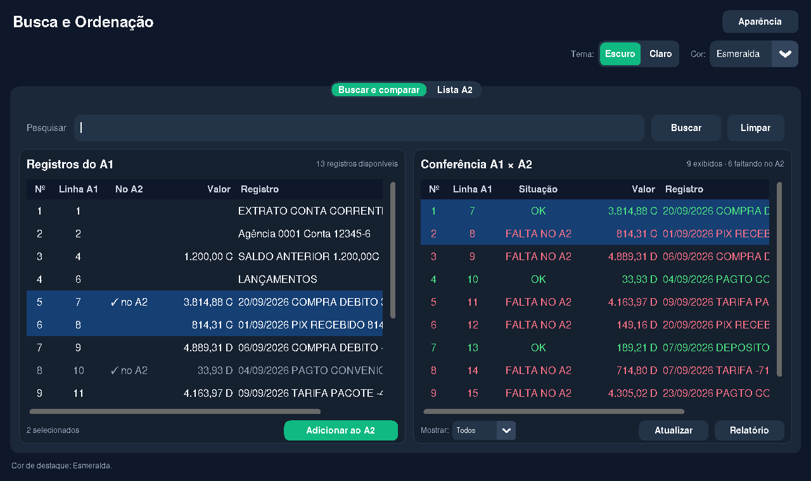
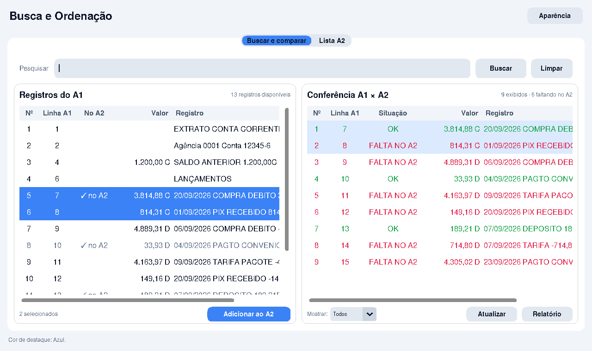
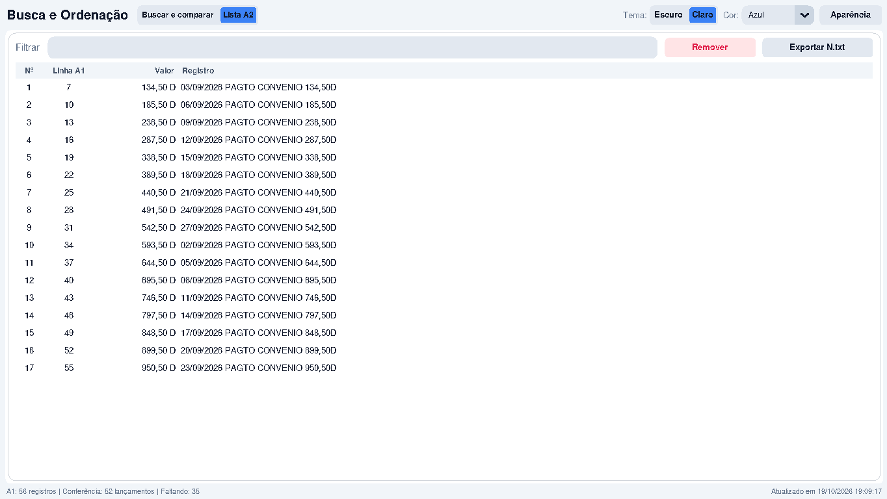
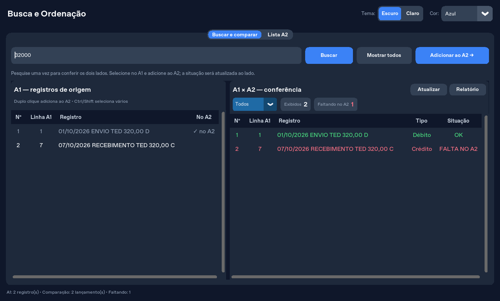
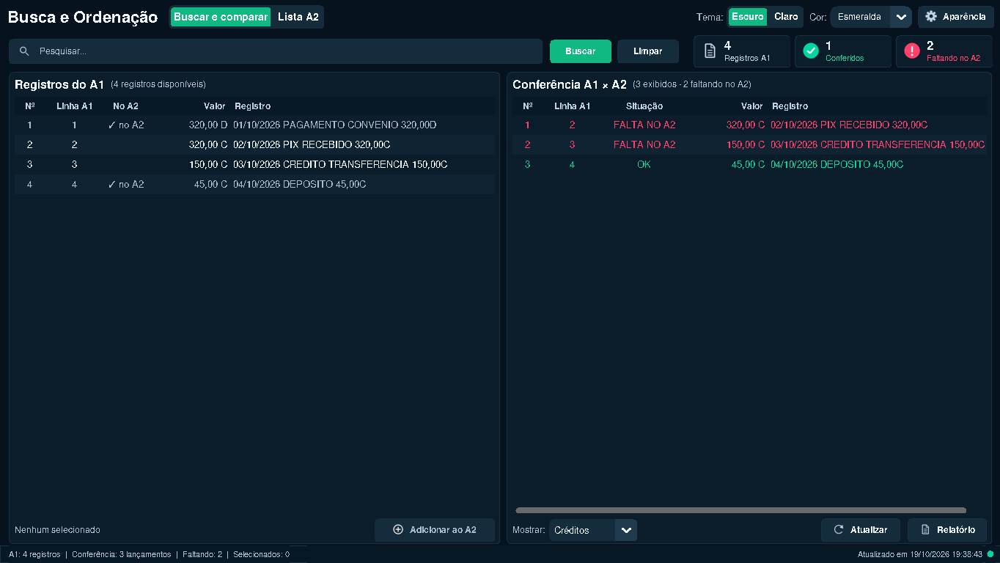

# Organiza-o

Aplicativo desktop em português, feito com CustomTkinter, para pesquisar registros
do A1, organizar uma seleção no A2 e comparar débitos e créditos em um relatório imprimível.

## Telas atuais

Capturas reais do aplicativo com dados fictícios, sem alterar arquivos de uso.
A aparência das fontes pode variar conforme o sistema operacional.

### Tela inicial — Buscar e comparar

Reúne os registros do **A1 à esquerda** e a **conferência A1 × A2 à direita**.
Uma única pesquisa filtra os dois painéis. Ao selecionar e usar **Adicionar ao A2**,
a situação é atualizada ao lado, mantendo a pesquisa. Arraste a divisória central
para ajustar o espaço de cada painel.

A barra superior reúne apenas **Pesquisar**, **Buscar** e **Limpar**. As duas
tabelas ficam alinhadas, em painéis com bordas finas e larguras iniciais iguais.
As contagens ficam na mesma linha dos títulos, alinhadas à direita.
**Adicionar ao A2** fica no rodapé do A1, ao lado da quantidade selecionada,
e só é habilitado com uma seleção. **Atualizar** e **Relatório** ficam no rodapé
da conferência. O filtro **Todos / Débitos / Créditos** fica no mesmo rodapé,
à esquerda dos botões. Os dois rodapés têm margens menores e botões de 32 pixels,
deixando mais altura para os registros. As linhas têm 36 pixels, mantendo o tamanho
da fonte e o espaço necessário para a leitura.
Os cartões e as instruções repetidas foram substituídos por resumos em texto.
Os seletores de tema e cor ficam recolhidos no botão **Aparência**.
A situação aparece antes do registro, ficando visível mesmo em linhas longas.
Na conferência, registros **OK** ficam em verde e **FALTA NO A2** em vermelho,
tanto no tema claro quanto no escuro.
O tema escuro usa fundos em azul profundo e o claro mantém os painéis brancos.
A seleção da conferência preserva o verde e o vermelho sobre um fundo azul
adequado a cada tema; linhas selecionadas no A1 e na Lista A2 usam texto branco.
O botão de inclusão fica neutro enquanto não houver seleção.

As três tabelas exibem a coluna **Valor**, alinhada à direita, antes de **Registro**.
Ela mostra o valor brasileiro e o marcador D/C, como `3.814,88 C`, e fica vazia em
linhas sem valor marcado com D/C. Essa apresentação não altera o registro original, os
arquivos, a pesquisa ou as regras de comparação.

As barras de rolagem aparecem apenas quando há conteúdo fora da área visível.
O cabeçalho aproveita melhor a altura da janela, e o filtro da Lista A2 se
expande com a largura disponível. A janela inicial considera o tamanho da tela;
mensagens longas no rodapé quebram linha para continuar legíveis.
Duplo clique adiciona apenas o registro clicado: cabeçalhos e áreas vazias não
adicionam a seleção anterior. Limpar a seleção também limpa o outro painel.

As capturas da tela inicial e da Lista A2 mostram esse layout. As capturas de
pesquisa e créditos são anteriores à reorganização. As tabelas têm linhas e cabeçalhos espaçados, sem
a coluna **Tipo**, e **Registro** é dimensionado pelo conteúdo.
Use a barra horizontal para ler linhas longas por inteiro e arraste a divisória
central para ampliar um dos painéis.





### Lista A2

Mostra os registros escolhidos, mantendo a referência original do A1. Permite
filtrar, remover e exportar a seleção.



### Pesquisa compartilhada

Pesquisar `32000` encontra os registros de `320,00` nos dois lados. Neste exemplo,
o débito já está no A2 e o crédito ainda falta: o mesmo valor com tipos diferentes
é conferido separadamente. **Limpar** limpa a pesquisa dos dois painéis.



### Filtro de créditos

O filtro da direita permite conferir somente créditos ou somente débitos; o A1
continua disponível à esquerda. Os contadores e o relatório acompanham a pesquisa
e o tipo selecionado. A sequência **Nº** recomeça em 1 e **Linha A1** mantém a referência original.



### Referências anteriores

A [captura anterior da interface](Interface.png) e o [diagrama original](Diagrama.png)
foram preservados como referência histórica.

## Executar

Requer Python 3.11 ou superior, Tk e uma sessão gráfica. Com o [uv](https://docs.astral.sh/uv/),
execute na pasta do projeto:

```sh
uv sync --frozen
uv run --frozen python main.py
```

O aplicativo cria `a1.txt`, `a2.txt` e a pasta `No/` no diretório de execução.
Mantenha esse diretório ao reiniciar para acessar os mesmos dados. Esses arquivos
são locais e ignorados pelo Git; faça cópias de segurança dos registros importantes.

## Uso e comparação

1. Preencha `a1.txt` com um registro por linha. Linhas vazias são ignoradas,
   preservando a numeração original. Use UTF‑8; arquivos UTF‑8 com BOM também são aceitos.
2. Em **Buscar e comparar**, digite texto, data ou valor e pressione Enter ou
   clique em **Buscar**. Por exemplo, `145330` encontra `1.453,30`.
   A pesquisa filtra simultaneamente o A1 e a comparação, preservando a ordem original.
   Os filtros de tipo e o relatório usam a última pesquisa confirmada; digitar
   um novo termo sem pressionar Enter ou **Buscar** não altera os resultados.
3. Selecione os registros à esquerda e clique em **Adicionar ao A2**, ou use
   duplo clique. A indicação no A1 e a situação na direita são atualizadas sem
   trocar de aba. A seleção localiza a mesma linha no painel ao lado; Ctrl/Shift
   permite escolher vários registros. A comparação contém lançamentos com D/C;
   saldos e o resumo do extrato ficam fora da contagem. Lançamentos futuros
   continuam disponíveis para conferência e mantêm a linha original do A1.
   Se o A1 for editado em outro programa e a linha escolhida mudar, a inclusão
   é interrompida e a lista atualizada para você selecionar novamente.
4. Confira as pendências à direita. **Todos / Débitos / Créditos** filtra o tipo
   apenas nesse painel, e os contadores mostram as quantidades visíveis. **Relatório**
   abre `No/relatorio_debitos.html` no navegador, com a mesma pesquisa e tipo.
   O nome do arquivo foi mantido para compatibilidade; ele agora inclui créditos também.
5. Em **Lista A2**, filtre, remova registros ou exporte a seleção para `No/N.txt`.
   A exportação contém todo o A2, na ordem das linhas originais.

A pesquisa não muda o resultado da conferência: os lançamentos são comparados
antes de filtrar a visualização, evitando que uma busca altere qual ocorrência
de um valor repetido está marcada como OK. Pesquisar uma data busca esse texto
no registro; a ordenação permanece pela linha original, sem interpretar datas.

Um débito é identificado por um valor brasileiro seguido de `D`, por exemplo
`Cliente 1.453,30 D`. Um crédito termina em `C`, como `Cliente 100,00 C`.
Os marcadores D/C identificam a saída e a entrada; o sinal negativo não é exigido.
O formato original com valor colado no histórico (`ENVIO TED320,00 D`) também é aceito.
Valores como
`1.453,30` e `1453,3` são equivalentes. Os registros adicionados diretamente do A1
têm prioridade pela linha e pelo texto originais, tolerando diferenças de espaços
e tabulações. Um item com referência `[linha]` só confere essa linha e o mesmo
texto: referências antigas, inexistentes ou repetidas não conferem outra linha
de mesmo valor. Itens do A2 **sem referência** são comparados por valor, na ordem
das linhas do A1. Cada ocorrência confere
apenas um lançamento do mesmo tipo: um crédito nunca confere um débito.
Dois créditos ou débitos de mesmo valor exigem duas ocorrências do respectivo tipo no A2.
**Situação** mostra `OK` ou `FALTA NO A2`; o valor e o marcador D/C permanecem
no registro, dispensando uma coluna **Tipo** na tabela e no relatório.
Valores negativos do extrato, como `-700,00D`, também são reconhecidos;
a conferência usa o valor absoluto e o marcador D/C.
Os contadores mostram quantidades de registros.
Linhas sem valor marcado com D/C, como `0SALDO DIA` no exemplo original,
continuam disponíveis no A1 e no A2, mas não entram na comparação financeira.

Todas as abas exibem **Nº** em ordem crescente de 1 até o fim da lista exibida,
sem limite de 30 registros. Ao filtrar A1 ou A2, essa sequência recomeça em 1.
**Linha A1** mantém a referência original, inclusive quando existem linhas vazias
ou registros que não são débitos. O A2 é exibido e exportado pela linha original do A1
(1, 2, 3…), independentemente da ordem de seleção. A numeração de
exibição não altera os arquivos nem os identificadores `[linha]` gravados no A2.
O relatório também contém as colunas **Nº** e **Linha A1**.

A ordem de referência é a sequência das linhas do A1. O identificador `[12]`
no A2 significa que o registro veio da linha 12 do A1; não representa o dia 12.
Códigos numéricos no começo do texto também não são tratados como datas.
Mesmo que uma descrição contenha datas, ela não muda a ordem original.
O arquivo de exemplo do commit `5ac63f7` contém 98 registros sem datas explícitas.

O relatório trata o conteúdo dos registros como texto, inclusive caracteres
como `<`, `>` e `&`. A impressão depende do navegador e da impressora disponível.

## Desenvolvimento e validação

Após `uv sync --frozen`, execute a suíte completa em uma sessão gráfica:

```sh
uv run --frozen python scripts/test.py --require-gui
```

No Linux com Xvfb instalado, use:

```sh
xvfb-run -a uv run --frozen python scripts/test.py --require-gui
```

O comando verifica comparação, cliques, seleção, rolagem, mensagens e
redimensionamento. Ele falha se houver erros, se nenhum teste for encontrado ou
se algum teste for ignorado. Para uma verificação parcial sem sessão gráfica,
omita `--require-gui`: os testes da interface serão indicados como ignorados,
e o resultado não valida a interface. A execução por
`python -m unittest discover -s tests -v` continua disponível.

O [workflow de testes](.github/workflows/tests.yml) executa a suíte completa no
Windows e no Linux, com Python 3.11 e 3.12, em pushes para `main` e pull requests.
Os testes usam arquivos temporários, preservando os dados de uso. As orientações
para agentes estão em [AGENTS.md](AGENTS.md).

As práticas foram adaptadas do repositório [mattpocock/skills](https://github.com/mattpocock/skills/tree/5beb35b040e3de97e54fa9e386d7e42d15c295c2),
especialmente [writing-for-agents](https://github.com/mattpocock/skills/blob/5beb35b040e3de97e54fa9e386d7e42d15c295c2/skills/productivity/writing-for-agents/SKILL.md)
e as recomendações de [testes por comportamento](https://github.com/mattpocock/skills/blob/5beb35b040e3de97e54fa9e386d7e42d15c295c2/skills/engineering/tdd/tests.md).
